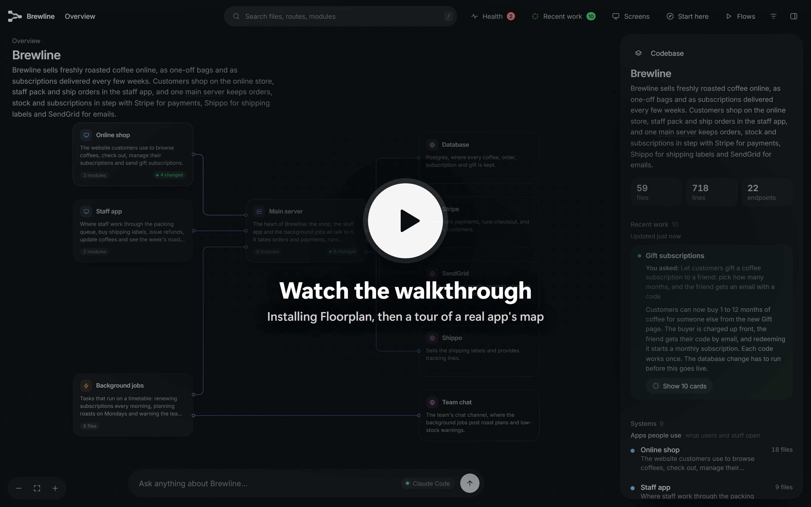
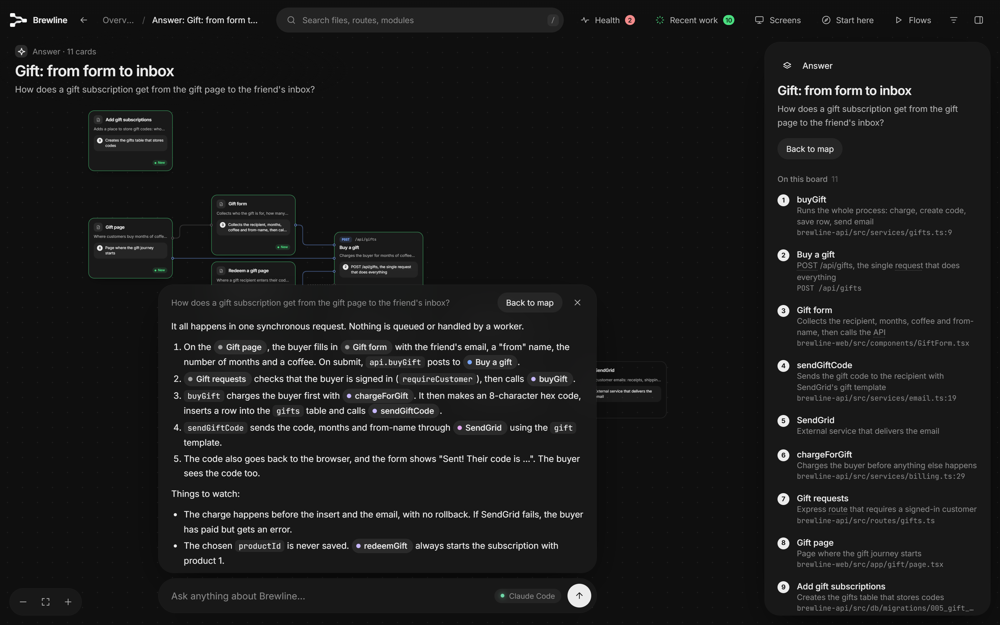
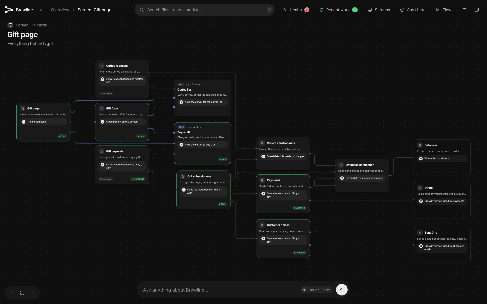
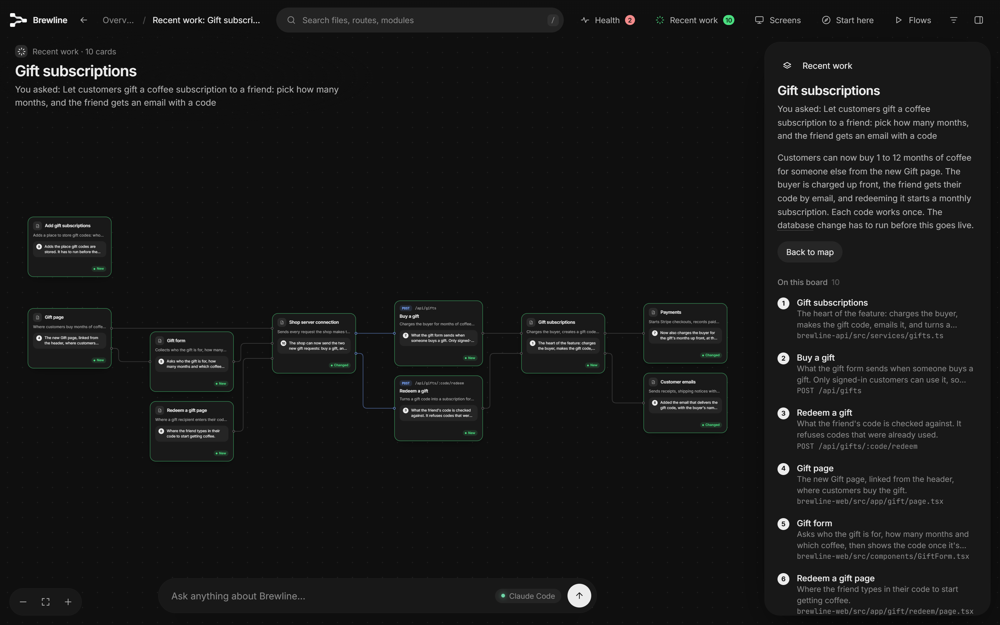
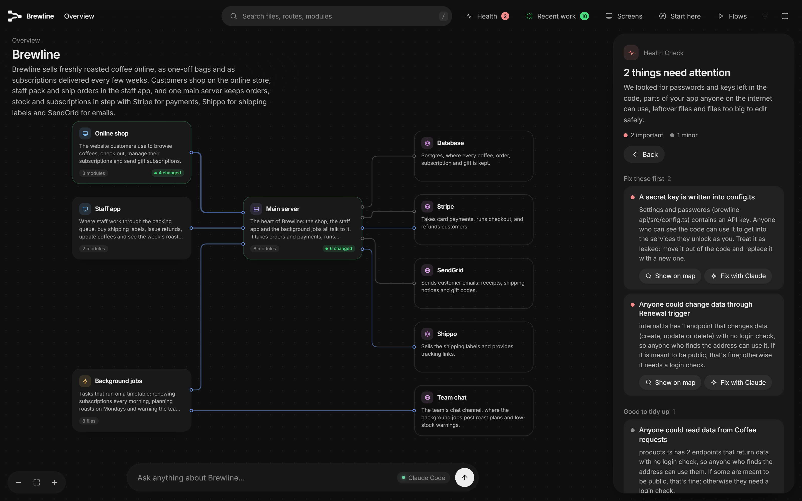
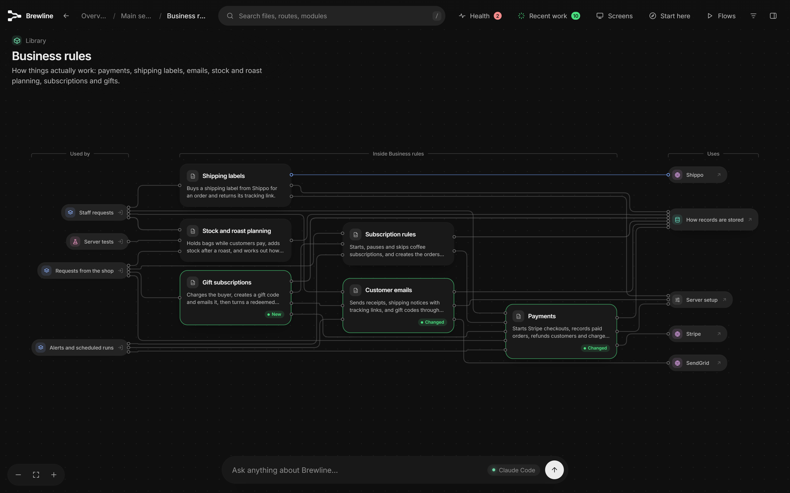
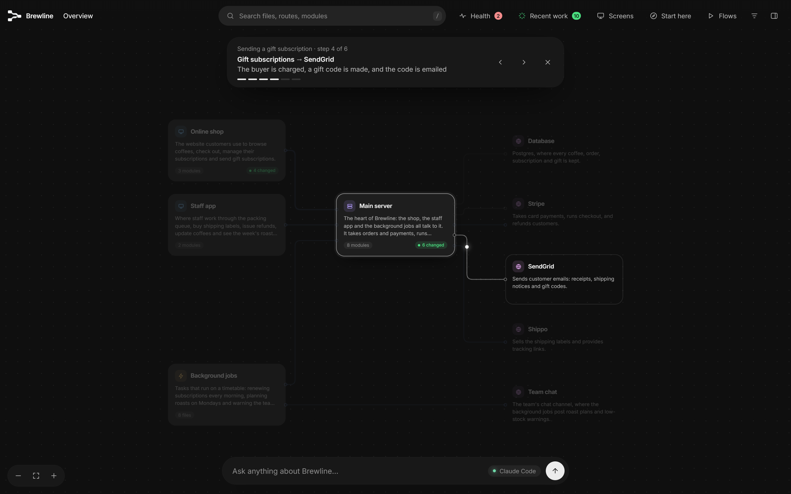
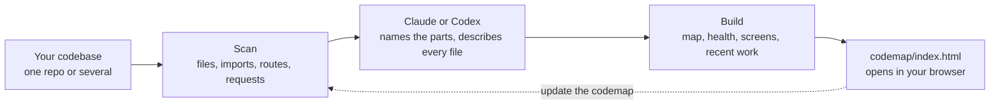

<div align="center">

<picture>
  <source media="(prefers-color-scheme: dark)" srcset="docs/images/logo-dark.png">
  
</picture>

# Codemap

**See how your app actually fits together.**

<sub>Codemap started as a fork of [Floorplan](https://github.com/haydenschmitty/floorplan) by Hayden Smith (MIT).</sub>

Claude or Codex reads your codebase and draws an interactive map of it. Every part, file and web request gets a plain-English name, and every connection between them is shown.

[](https://code.claude.com/docs/en/overview)
[](docs/codex.md)
[](https://github.com/Huzaifa-367/codemap/actions/workflows/test.yml)
[](CHANGELOG.md)
[](LICENSE)
[](https://nodejs.org)
[](#how-it-works)

**[Try the live demo](https://haydenschmitty.github.io/codemap-demo/)** · [Watch the video](https://youtu.be/NTUUzC7L_NQ) · [Install](#install) · [Quick start](#quick-start) · [Compared](#codemap-archify-or-understand-anything) · [Features](#features) · [See it in action](#see-it-in-action) · [How it works](#how-it-works) · [Docs](docs/README.md) · [FAQ](#faq)

</div>

<p align="center">
  <a href="https://youtu.be/NTUUzC7L_NQ"></a>
</p>
<p align="center"><sub>▶ <a href="https://youtu.be/NTUUzC7L_NQ">Watch the walkthrough</a>: installing Codemap, then a tour of Brewline, a demo coffee-subscription app built across four repos.</sub></p>
<p align="center"><b><a href="https://haydenschmitty.github.io/codemap-demo/">Try the live demo →</a></b> Explore the Brewline map in your browser, no install needed.</p>

## Why Codemap?

You built an app, probably with a lot of help from AI, and it works. But ask "what happens when someone checks out?" or "what breaks if I change this?" and the honest answer is *no idea*.

Codemap gives you the diagram nobody drew. Ask Claude Code or Codex for a codemap and a few minutes later you have a map you can explore, ask questions on, and keep up to date as you work.

- **For builders:** understand the app you made, in your own words, without reading the code.
- **For teams:** onboard someone in minutes, from the big picture down to the exact file.
- **For working with AI:** after every change Claude or Codex makes, see exactly which parts it touched and why.

## New in 0.7 – 0.9: every level, every app, built for agents

- **From the whole system down to one function.** Apps (web, servers, **Flutter, Android, iOS, React Native**), their parts, files, screens and endpoints, and now every function and the calls between them. Each app's requests are matched to the server endpoints that answer them, even across repos.
- **Trace any flow for free.** "What happens when someone books a trip?" follows it from the screen through the view model, use case, repository and API client, across the request, to the server's handler and the database. On the map (**Follow it → Trace the flow**), as a sequence diagram, or saved under Flows. No tokens.
- **What does my change break?** Changed files → everything that uses them, other apps calling a changed endpoint, screens to re-check, Health issues. Uncommitted work, a branch, or a PR summary. No tokens.
- **Made for coding agents.** `node codemap/query.mjs context "<task>"` gives Claude Code or Codex the exact line ranges a task needs instead of a round of grep and cat (about 16× less reading on Flutter's Compass sample); `fn`, `map`, `trace`, `impact` and `--brief` for subagents. See [docs/AGENT-EFFICIENCY.md](docs/AGENT-EFFICIENCY.md).
- **Health for mobile apps** (unencrypted connections, debuggable builds, emulator addresses) on top of the existing checks.
- **The data model:** tables from SQL migrations and Prisma, which code reads or writes each one (Supabase, Prisma, SQL), flows that end at the table, and an ERD (`query.mjs erd`).
- **More lenses:** Layers (screens, API, logic, data…), business Domains, the **Functions map** of any file, a notice when the map is behind the code, what changed since the last map (`query.mjs delta`), and Save the board as a page or the view as an image.
- **Function-level flows on every map:** Flows → *Step by step: …* opens a board of function cards from a screen to the server's handler and the data, with an arrow for each call, traced with no tokens.
- **Every function on the map:** in technical detail a file opens into its functions, with arrows for every call inside it and in and out of it.
- **More frameworks and agents:** NestJS, Spring, Gin/Echo/chi, Laravel, Rails, ASP.NET; Cursor, Copilot, Gemini CLI, OpenCode, Cline, Kiro and Trae ([guide](docs/other-agents.md)). Maps, and the map's own buttons, can be in your language.

How it compares with Understand-Anything and Archify, and what we took from each: [docs/COMPETITIVE.md](docs/COMPETITIVE.md).

## Codemap, Archify or Understand Anything?

All three turn code into something you can see, and all three are worth knowing. They answer different questions:

| | **Codemap** | **[Archify](https://github.com/tt-a1i/archify)** | **[Understand Anything](https://github.com/Egonex-AI/Understand-Anything)** |
|---|---|---|---|
| **The question it answers** | How does the app I built actually work, and what should I worry about? | How do I show this clearly? | How does this big codebase work, down to the functions? |
| **Made for** | People who build with AI and don't read the code | Anyone explaining a system, a process or an idea | Developers getting to know a large codebase |
| **What you get** | A zoomable map of every app (web, servers, Flutter, Android, iOS) from the parts down to each function, the requests between apps (even across repos), screens, the database tables, and outside services | A polished diagram in one of 10 types (architecture, sequence, ERD…) or a one-page explainer, from a repo or just a description | A knowledge graph of every file, function and class, with layers, a business-domain view and guided tours |
| **Only here** | **Health check** (keys in code, open Supabase tables and Firebase rules, fakeable Stripe webhooks, endpoints anyone can use, mobile apps that allow unencrypted connections), **Recent work**, flows traced from a screen to the table for free, change impact across apps, and line-range context that saves coding agents most of their search tokens | 10 diagram types, image and video exports, diagrams of things that aren't code | A dashboard that adapts to your role, knowledge-base graphs |
| **Runs in** | Claude Code, Codex, Cursor, Copilot, Gemini CLI, OpenCode, Cline, Kiro, Trae | Claude Code, Codex, Cursor, OpenCode and more | Claude Code, Codex, Cursor, Copilot, Gemini CLI and more |

**Pick Codemap** to understand and check an app you own. **Pick Archify** to draw a diagram for a doc, a talk or a decision. **Pick Understand Anything** for an AI-written explanation of every file in a very large codebase.

They also work together: map your app with Codemap, then use Archify to draw one flow for a presentation.

## Features

<table>
<tr>
<td width="50%" valign="top">

**🗺️ A map at every zoom**<br>
Start with the whole app, then double-click into a part, a group of files, a file, and its endpoints. Each view shows what it's used by and what it uses.

</td>
<td width="50%" valign="top">

**💬 Plain English everywhere**<br>
"Takes card payments at checkout", not "Stripe API wrapper". Technical terms are explained on hover, and one switch shows the developer view.

</td>
</tr>
<tr>
<td valign="top">

**🔌 Real connections, across repos**<br>
It follows imports, and matches each web request in your frontend to the server endpoint that answers it, even across separate repos.

</td>
<td valign="top">

**🖥️ Start from a screen**<br>
Pick a page you know and see everything behind it: its parts, the requests it makes, the server code, the data, and outside services.

</td>
</tr>
<tr>
<td valign="top">

**🧭 Ask the map**<br>
"How does a refund reach the customer's card?" comes back as an answer plus a mini-map of just the pieces involved, with a step-by-step walkthrough.

</td>
<td valign="top">

**🩺 Health check**<br>
Catches the classic mistakes in AI-built apps: keys in the code or sent to the browser, Supabase tables anyone can read, open Firebase rules, Stripe webhooks anyone could fake, and endpoints with no sign-in. Each comes with a ready-to-paste fix. A check, not an audit.

</td>
</tr>
<tr>
<td valign="top">

**🟢 Recent work**<br>
The cards your AI just changed light up green, each with a note on how the change serves what you asked for.

</td>
<td valign="top">

**⚡ Stays current, stays yours**<br>
Updates re-read only what changed, and an open map reloads itself. Everything runs on your machine, and nothing is committed to git.

</td>
</tr>
</table>

Plus guided **flows** you can request in plain words, a one-minute **Start here** tour, **Export** to send a copy to anyone as one HTML file, a layout for **phones and tablets** with drag and pinch, search, keyboard shortcuts, and right-click actions on every card.

### Also: blueprints, for apps you haven't built yet

Codemap is made for mapping code you already have. It can also start from a PRD, a spec or a description of something you want to build, and draw a **blueprint**: the same kind of map, showing every part, file, endpoint and screen you'd need and how they'd fit together. Cards are dashed to show it's a plan. Instead of a Health check you get a review of what the plan still leaves open, each part has a ready request to build it, and you can reshape the plan from the map ("also plan out refunds"). Once the code exists, the blueprint becomes a map of the real thing. See [Plan something you haven't built yet](docs/getting-started.md#plan-something-you-havent-built-yet).

## See it in action

Want to click around yourself? Open the [live demo](https://haydenschmitty.github.io/codemap-demo/): the real Brewline map beside a scripted conversation, in Claude Code or Codex.

<table>
<tr>
<td width="50%" valign="top">

<p><b>Ask the map.</b> A real answer, from the Claude Code CLI in 31 seconds. It traced the gift from form to inbox across two repos, and spotted two bugs along the way.</p>
</td>
<td width="50%" valign="top">

<p><b>Start from a screen.</b> Pick any page and see everything behind it, from the button down to the database and outside services.</p>
</td>
</tr>
<tr>
<td valign="top">

<p><b>Recent work.</b> What you asked for, what changed, and why each change was needed, on one board.</p>
</td>
<td valign="top">

<p><b>Health check.</b> A password left in the code and an endpoint anyone can call, each with a one-click fix prompt.</p>
</td>
</tr>
<tr>
<td valign="top">

<p><b>Zoom in.</b> Inside any part: what's in it, what uses it, and what it relies on. Green tags mark what just changed.</p>
</td>
<td valign="top">

<p><b>Guided flows.</b> Watch a request travel through the app step by step, or ask for a new one to be traced.</p>
</td>
</tr>
</table>

## Install

You need [Node.js 18+](https://nodejs.org) and either Claude Code or Codex. Codemap runs on the plan you already have, with no API keys.

### Claude Code

In the desktop app's Code tab or the CLI:

```bash
claude plugin marketplace add Huzaifa-367/codemap
claude plugin install codemap@codemap
```

Start a new session and it's ready. Installing the Claude Code CLI is recommended even if you use the desktop app, because it lets the map's Ask bar read your real code. More in [Getting started](docs/getting-started.md).

### Codex

Signed in with ChatGPT. No terminal needed:

1. In the Codex app, open **Plugins** and choose **Add a marketplace**.
2. For **Source**, enter `Huzaifa-367/codemap` and click **Add marketplace**.
3. Find **Codemap** and click **+** to install it.

Or, from a terminal:

```bash
codex plugin marketplace add Huzaifa-367/codemap
codex plugin add codemap@codemap
```

Start a new chat and ask for a codemap, or type `$codemap`. The map's Ask bar runs on your own Codex sign-in, with no API key. More in [Codemap in Codex](docs/codex.md).

## Quick start

1. Open your project in Claude Code or Codex. For a frontend and backend in separate repos, open the folder that holds both.
2. Ask:
   > Make me a codemap of this app.

   (In Codex you can also type `$codemap`.)
3. Explore. The map opens on its own, starting with a short tour.

When you've done more work, ask:

> Update the codemap.

Only what changed is re-read, and what you just worked on lights up under **Recent work**.

**No code yet?** Codemap can plan an app from a PRD or spec instead. Share the document and ask:

> Here's my PRD. Make me a codemap of what we'd need to build.

You get a [blueprint](#also-blueprints-for-apps-you-havent-built-yet) of the planned system, clearly marked as a plan.

### Things to try

| Ask Claude Code or Codex | Ask the map |
|---|---|
| "Make me a codemap of this app" | "What happens when someone places an order?" |
| "Update the codemap" | "Where do we talk to Stripe?" |
| "Fix the important issues from the codemap's Health check" | "If I change the users table, what breaks?" |
| "Add a flow showing how a new user signs up" | "Which files handle login?" |
| "Rewrite the codemap for developers" | "What did we change for refunds?" |
| "Export the codemap so I can send it to the team" | |

## How it works



Scripts do the mechanical work: finding repos, parsing code in a dozen languages, matching web requests to endpoints, laying out the map. They're plain Node with no dependencies. Claude or Codex does the part only a reader can: deciding what the parts of your app *are*, and saying so plainly. Details in [How it works](docs/how-it-works.md).

**Languages:** TypeScript, JavaScript, Python, Go, Rust, Java, Kotlin, Scala, Dart and Swift, plus Vue, Svelte and Astro files, with lighter support for others.<br>
**Apps:** websites, servers and mobile apps (Flutter, native Android, native iOS, React Native and Expo), side by side in one folder. Each app's requests are matched to the server endpoints that answer them.<br>
**Endpoints:** Express, Koa, Hono, Fastify (both forms), NestJS, Next.js, Firebase Cloud Functions, Flask, FastAPI, Django, Go's net/http, Gin, Echo and chi (with groups), Actix, Axum, Spring, Laravel, Rails, ASP.NET (attributes and minimal APIs), Dart's shelf_router and dart_frog.<br>
**Screens:** Next.js, React Router, Vue, SvelteKit, Remix, Nuxt, Astro, Expo, Angular, TanStack, and in mobile apps go_router, auto_route and Flutter route tables, Jetpack Compose navigation, Android activities and navigation graphs, SwiftUI and UIKit.

## What it adds to your project

A `codemap/` folder holding the map. In Claude Code, if you say yes, it also adds a short section to `CLAUDE.local.md` so future sessions know the map is there. **Neither is committed:** the folder ignores itself in git, and `CLAUDE.local.md` goes in your clone's private ignore list. In Codex, only the `codemap/` folder is added. Your `.gitignore` and other tracked files are never touched. See [What's in your project](docs/project-files.md).

## Privacy

- The scan, the map and its small local server all run on your computer. The server only accepts connections from your own machine.
- No dependencies or install scripts, and the map works offline: its layout engine and fonts are built in.
- Questions on the map go to your own account, through the Claude Code CLI or Codex, which can read your code but not change it.
- The Health check never stores or shows secret values, only where they are.
- No analytics or tracking. The map may ask once whether you'd like an email when Codemap Cloud launches. Nothing is sent unless you sign up, and then only your email and "just me" or "with my team".

More in [Privacy and security](docs/privacy-and-security.md). Wondering whether a plugin is safe to install? [Is it safe to install?](docs/is-it-safe.md) lists everything Codemap does on your computer, how a test checks that on every change, and how to verify your copy.

## Documentation

| | |
|---|---|
| [Getting started](docs/getting-started.md) | Install, first map, updating, planning from a PRD, removing |
| [Codemap in Codex](docs/codex.md) | Installing and using it in Codex |
| [Other coding agents](docs/other-agents.md) | Cursor, Copilot, Gemini CLI, OpenCode, Cline, Kiro, Trae |
| [Using the map](docs/using-the-map.md) | Every button, view, shortcut and menu |
| [How it works](docs/how-it-works.md) | The pipeline, connection matching, refreshes |
| [What's in your project](docs/project-files.md) | Every file Codemap creates, and how to edit it |
| [Privacy and security](docs/privacy-and-security.md) | What runs where, and what leaves your machine |
| [Is it safe to install?](docs/is-it-safe.md) | No hooks, MCP servers, dependencies or downloads; every program it runs; checking your installed copy |
| [Troubleshooting](docs/troubleshooting.md) | Common problems and fixes |
| [Developing Codemap](docs/development.md) | Repo layout, local installs, releases |

## FAQ

<details>
<summary><b>Is it safe to install?</b></summary>

Codemap has no hooks, no MCP servers and no dependencies, downloads nothing, and never runs code from the internet. Its only outside request is the opt-in waitlist. A test checks all of that on every change, and every release lists a fingerprint of each file so you can confirm your installed copy is the real thing. Everything is in [Is it safe to install?](docs/is-it-safe.md).
</details>

<details>
<summary><b>Does my code leave my computer?</b></summary>

Only the way Claude Code and Codex always work: the AI reads the files it needs to describe your app, through your own account. The map itself is a local file and its server only listens on your machine. If you choose to open the map in the Claude app instead, Claude uploads the map (names, descriptions and structure, not your source code) to your private claude.ai account, and asks first. The one thing Codemap itself ever sends is your email, and only if you sign up for the [Codemap Cloud waitlist](docs/privacy-and-security.md#codemap-cloud-waitlist).
</details>

<details>
<summary><b>How long does it take, and what does it cost?</b></summary>

A first map takes a few minutes for a small app and longer for a big one, because every file and endpoint gets described. It uses your Claude or ChatGPT plan like any other task. Big projects are split across parallel helpers. Updates re-read only what changed, so they're quick and cheap.
</details>

<details>
<summary><b>Do I need a CLI for the Ask bar?</b></summary>

No. The map works without one. The Ask bar answers through the Claude Code CLI or Codex, which can read your real code. Codex's desktop app already includes what it needs. With Claude, without the CLI you can ask from the Claude app instead, using the map alone.
</details>

<details>
<summary><b>Will it change or commit my files?</b></summary>

It only writes its own `codemap/` folder (and, in Claude Code if you say yes, a section in `CLAUDE.local.md`), and neither is committed. It never changes your code, your `.gitignore` or your `CLAUDE.md`.
</details>

<details>
<summary><b>The names it picked aren't how we talk about it. Can I change them?</b></summary>

Yes. Just ask ("rename 'Main server' to 'Shop API' on the codemap"), or edit `codemap/architecture.json` and `codemap/descriptions/` yourself. Your edits are kept on every update.
</details>

<details>
<summary><b>Does it work with Codex as well as Claude Code?</b></summary>

Yes. It's the same plugin, the same map and the same Health check. Each app runs it on your own plan: Claude Code on your Claude account, Codex on your ChatGPT sign-in. A map made in one opens fine with the other. See [Codemap in Codex](docs/codex.md).
</details>

<details>
<summary><b>Can I use it before I've written any code?</b></summary>

Yes, though mapping existing code is what it's mainly for. Share a PRD, a spec or a description of your app and ask for a codemap, and you get a blueprint: a map of what you'd need to build, marked as a plan, with a review of the decisions still open. You can change it from the map, then switch to a map of the real code once it's built. See [Plan something you haven't built yet](docs/getting-started.md#plan-something-you-havent-built-yet).
</details>

<details>
<summary><b>Does it work on monorepos and multi-repo setups?</b></summary>

Yes. Point it at a monorepo, a subfolder of one, or a plain folder that holds several repos side by side. It finds every repo and connects them.
</details>

<details>
<summary><b>How is this different from Archify or Understand Anything?</b></summary>

Archify draws diagrams of anything, and Understand Anything builds a developer's knowledge graph of a codebase. Codemap maps the app you built, in plain English, and tells you what's risky and what your AI just changed. See [Codemap, Archify or Understand Anything?](#codemap-archify-or-understand-anything)
</details>

## Contributing

Issues and pull requests are welcome. See [CONTRIBUTING.md](CONTRIBUTING.md) and [Developing Codemap](docs/development.md).

## License

[MIT](LICENSE) © 2026 [Hayden Smith](https://github.com/haydenschmitty)
